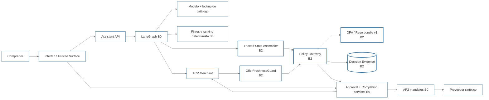
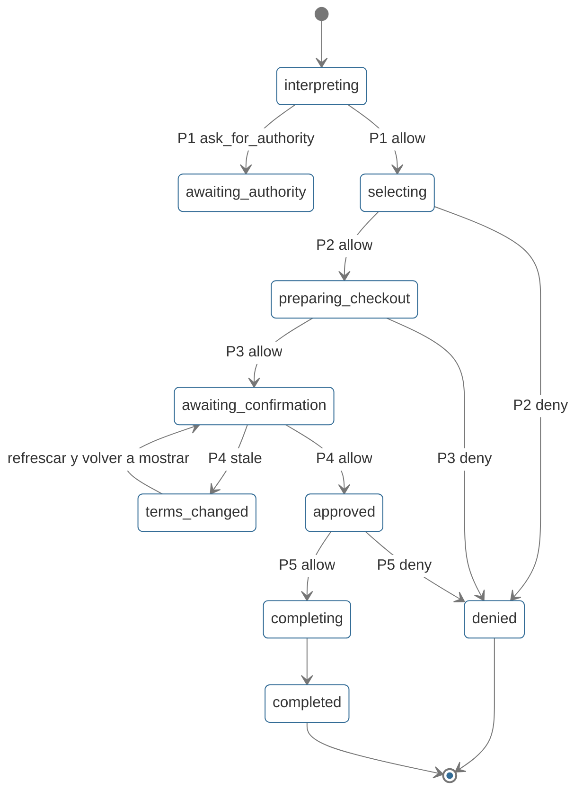

# Arquitectura B2

> Borrador original P1–P5. El enfoque de gobernanza recibió el visto bueno el 9 de octubre,
> según el reporte de Yair del 11 de octubre; esta arquitectura aún debe reconciliarse con
> [D1/D2](design-review.md) y la investigación de protocolos. El
> [plan de cierre](design-closure-2026-10-11.md) define el trabajo vigente.

## Vista de componentes

La siguiente vista copia el recorrido B0 y resalta únicamente los componentes añadidos por B2.



La UI sigue mostrando candidatos como información, pero **la elección vinculante es la que se
presenta en términos cerrados para aprobación**. El usuario puede rechazar o volver a conversar; no
se interpreta la navegación por candidatos como consentimiento. Esto preserva el valor de la
recomendación agéntica sin confundir exploración con aprobación.

## Puntos de decisión

| Punto | Momento | Estado autoritativo usado | Resultado esperado |
|---|---|---|---|
| P1 `intent` | Después de interpretar la solicitud | Intención validada y campos presentes | `allow` para buscar o `ask_for_authority` con campos faltantes |
| P2 `selection` | Después de que el modelo propone una variante | Conjunto elegible calculado, variante elegida, restricciones | `allow` solo si la variante pertenece al conjunto elegible |
| P3 `checkout` | Antes de mostrar términos | Checkout ACP releído, moneda, líneas, total, revisión y expiración | `allow` o `deny`; nunca mostrar términos que contradigan la intención |
| P4 `approval` | Al recibir el clic humano | Principal autenticado, checkout actual, revisión y huella mostrada | Aprobar solo la misma oferta; si cambió, invalidar y volver a presentar |
| P5 `completion` | Inmediatamente antes del efecto | Últimas decisiones, aprobación, mandates AP2, checkout y revisión actuales | Completar una vez o fallar cerrado |

## Flujo gobernado

```mermaid
%%{init: {"theme":"base","themeVariables":{"fontFamily":"Arial","primaryColor":"#FFFFFF","primaryTextColor":"#333333","primaryBorderColor":"#336C96","lineColor":"#767676","actorBkg":"#FFFFFF","actorBorder":"#333333","actorTextColor":"#333333","signalColor":"#767676","signalTextColor":"#333333","labelBoxBkgColor":"#FFFFFF","labelBoxBorderColor":"#D0D0D0","noteBkgColor":"#F7F7F7","noteBorderColor":"#767676"}}}%%
sequenceDiagram
    actor U as Comprador
    participant UI as Trusted Surface
    participant A as Agente B0
    participant S as State Assembler
    participant P as Policy Gateway / OPA
    participant M as Merchant ACP
    participant AP as Approval + AP2

    U->>UI: Solicitud de compra
    UI->>A: Turno autenticado
    A->>A: Interpretar + filtrar catálogo
    A->>S: Intención, candidatos, elección y procedencia
    S->>P: P1/P2 PolicyInput tipado
    alt falta autoridad o restricciones
        P-->>A: ask_for_authority(reason, required_fields)
        A-->>UI: Pregunta determinista
    else selección no permitida
        P-->>A: deny(reason)
        A-->>UI: Explicación segura, sin checkout
    else permitida
        P-->>A: allow(decision_id)
        A->>M: Crear y releer checkout
        M-->>A: Términos + revisión + expiración
        A->>P: P3 checkout actual
        P-->>A: allow
        A-->>UI: Mostrar términos cerrados
        U->>UI: Aprobar explícitamente
        UI->>AP: run_id + fingerprint
        AP->>M: Releer oferta/check-out
        M-->>AP: Estado actual
        AP->>P: P4 principal + oferta + fingerprint
        alt cambió un término material
            P-->>AP: deny(STALE_OFFER)
            AP-->>UI: Invalidar; mostrar términos nuevos
        else vigente
            P-->>AP: allow
            AP->>AP: Firmar mandates AP2
            AP->>P: P5 estado final
            P-->>AP: allow
            AP->>M: Completar con AP2
            M-->>UI: Pedido + recibos
        end
    end
```

## Fronteras de confianza

| Dato | Clasificación | Regla |
|---|---|---|
| Texto del usuario | No confiable, pero expresa intención | Se parsea y valida; no transporta identidad ni autoridad |
| Salida del modelo | Propuesta no autoritativa | Nunca se ejecuta sin filtros y decisión de política |
| Feed/descripción del catálogo | No confiable | Solo campos permitidos; el texto no se usa como regla ni instrucción |
| Conjunto elegible | Derivado confiable | Lo calcula código determinista con restricciones tipadas |
| Checkout ACP | Fuente comercial autoritativa, entrada externa | Se valida por esquema/firma/revisión y se relee en P3–P5 |
| Principal/propietario | Autoritativo | Derivado del JWT verificado por el servidor, nunca del modelo o cliente |
| Política | Autoritativa y versionada | Bundle fijado, validado y con digest registrado |
| Aprobación | Evidencia autoritativa de consentimiento | Atada a principal, checkout, revisión, términos y expiración |
| Mandates AP2 | Evidencia criptográfica | Firmados únicamente después de P4 y verificados en merchant/proveedor |

## Persistencia añadida

`policy_decisions` es append-only y no almacena secretos:

| Campo | Uso |
|---|---|
| `decision_id`, `run_id`, `trace_id`, `phase` | Correlación |
| `policy_bundle_version`, `policy_bundle_digest` | Reproducibilidad |
| `input_schema_version`, `input_sha256` | Integridad sin duplicar datos sensibles |
| `outcome`, `reason_codes`, `obligations` | Resultado explicable |
| `decided_at`, `latency_ms` | Orden y costo |
| `redacted_evidence_json` | Evidencia mínima aprobada por esquema |

`offer_snapshots` conserva la revisión, expiración, total, moneda, líneas normalizadas y hash. Una
nueva revisión no sobrescribe la anterior; permite demostrar por qué una aprobación se invalidó.

## Estados nuevos del flujo



`awaiting_authority` no es un error: es una pausa segura y recuperable. `terms_changed` exige una
nueva acción humana; nunca reutiliza el clic anterior.
