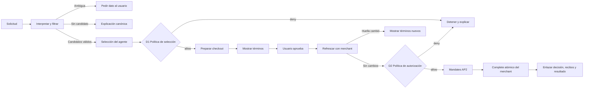

# Revisión crítica del diseño B2

Estado: revisión del 7 de octubre; recomendación técnica por cerrar  
Fecha: 2026-10-07  
Actualización del 2026-10-11: enfoque de gobernanza aprobado en la reunión del 9; diseño detallado activo

El reporte de la reunión no determina si se aprobó esta alternativa D1/D2 en particular. Sus
decisiones pendientes forman parte del [plan de cierre del diseño](design-closure-2026-10-11.md).

## Veredicto

La dirección de B2 sí responde al objetivo de la tesis: hacer explícitas y reconstruibles las
decisiones que permiten que un agente avance hacia una compra. Sin embargo, la propuesta original
de diez reglas y cinco llamadas al motor de políticas no debe implementarse tal como está. Mezcla
política, UX, invariantes de seguridad y concurrencia comercial; duplica controles que B0 y el
merchant ya tienen; y añade puntos de fallo que dificultarían atribuir causalmente los resultados.

La recomendación es un **B2 slim**: dos decisiones externas de gobernanza, recuperación y
validaciones deterministas en la aplicación, verificación de frescura inmediatamente antes de la
aprobación y AP2 + validación atómica del merchant como barrera final.

## Problemas observados que B2 debe resolver

| Brecha de B0 | Evidencia | Qué debe cambiar en B2 |
|---|---|---|
| Recuperación cuando no hay candidato | S02: 0/5 | Respuesta canónica y accionable; no error técnico |
| Aprobación de términos mostrados que quedaron obsoletos | S04: 0/5 | Refrescar términos, comparar huella e invalidar la aprobación |
| Reconstrucción incompleta de la decisión | completitud 0,4667 | Evidencia enlazada de decisión, aprobación, AP2 y resultado |

S01, S03 y S05 ya pasan 5/5. B2 debe conservar ese comportamiento y no reemplazar controles que
ya funcionan.

## Separación de responsabilidades

| Tipo de control | Ejemplos | Dueño recomendado |
|---|---|---|
| Flujo y UX | Ambigüedad, campos faltantes, cero candidatos, explicación | Orquestador determinista |
| Política de decisión | Selección dentro del conjunto elegible, acción permitida bajo restricciones | `PolicyEvaluator` |
| Seguridad de runtime | Ownership, huella exacta, idempotencia, fail closed, persistencia | Servicios de aplicación |
| Estado comercial | Precio, disponibilidad, revisión, expiración, TOCTOU | Merchant autoritativo |
| Consentimiento y efecto | Aprobación Human Present, mandates y recibos | AP2 + merchant + proveedor |

Esto evita tratar cada `if` de seguridad como si fuera una política declarativa. Una política decide
si una acción está permitida; un invariante garantiza que el sistema no pueda ejecutar una acción
con estado inválido.

## Arquitectura recomendada

### D1 — Decisión de selección

Se ejecuta después de interpretar la intención y calcular deterministicamente los candidatos
elegibles, antes de crear el checkout.

Entrada mínima: intención tipada, restricciones explícitas, ids elegibles y variante elegida.

Resultado: `allow` o `deny`, con versión de política, razones y huella de entrada. La ambigüedad no
se denomina falta de autoridad: el orquestador devuelve `require_user_input` antes de esta decisión.

### D2 — Decisión de autorización

Se ejecuta después del clic humano, pero antes de firmar mandates AP2. Primero el servidor refresca
el checkout contra el estado actual del merchant y vuelve a calcular su huella.

- Si la huella cambió, la aprobación no se reutiliza: se muestran los términos nuevos.
- Si no cambió, la política verifica principal, decisión previa y acción permitida.
- Solo entonces se firman los mandates AP2 y se solicita la finalización.

La actualización de frescura necesita un `approval_request_id` o una clave de idempotencia nueva por
intento humano. Reutilizar siempre la misma clave podría devolver una actualización antigua.

### Barrera final

No se añade una tercera decisión de política salvo que existan hechos de autorización que puedan
cambiar después de la aprobación —por ejemplo, revocación o presupuesto organizacional dinámico—.
En el alcance B2C actual, AP2 y el `complete()` atómico del merchant ya verifican checkout, revisión,
oferta vigente e idempotencia antes del efecto. B2 registra esa evidencia en lugar de duplicarla.

## Flujo propuesto

## Alternativas evaluadas

| Alternativa | Ventaja | Riesgo | Veredicto |
|---|---|---|---|
| A. Solo controles tipados en Python | Menor complejidad y latencia | La contribución de “gobernanza externa” queda débil | Viable si la tesis evalúa controles, no policy-as-code |
| B. OPA detrás de `PolicyEvaluator`, solo D1 y D2 | Política versionada, auditable y separada; tratamiento claro | Servicio adicional y fail-closed operacional | **Recomendada si B2 mide gobernanza externa** |
| C. OPA en P1–P5 | Máxima uniformidad aparente | Duplicación, latencia, ruido causal y cinco puntos de fallo | No recomendada |
| D. Cedar | Modelo fuerte principal/acción/recurso | Menos natural para obligaciones y recuperación B2C | No recomendada para este alcance |

## Cambios frente a la propuesta original

- P1 se convierte en recuperación determinista del flujo.
- P2 se conserva como D1.
- P3 vuelve a las validaciones tipadas que B0 ya ejecuta.
- P4 se divide en refresco determinista de frescura + D2.
- P5 queda cubierto por AP2 y la transacción atómica del merchant, con evidencia enlazada.
- `ask_for_authority` se reemplaza por `require_user_input` para datos faltantes; la aprobación
  explícita sigue siendo el acto de autorización.
- El ledger almacena decisiones materiales, no cada validación interna.

## Preguntas que deben cerrarse antes de implementar

1. ¿La variable experimental es “gobernanza explícita” o específicamente “policy-as-code externo”?
2. ¿Habrá políticas que cambien sin desplegar la aplicación? Si no, el beneficio de OPA es menor.
3. ¿B2 seguirá siendo solo B2C Human Present? Si incluye presupuesto o revocación B2B, vuelve a
   justificarse una evaluación justo antes de `complete`.
4. ¿S04 mide correctamente aprobación inválida aunque el merchant impediría el pago después? La
   recomendación es mantenerlo: aceptar autoridad sobre términos obsoletos sigue siendo un fallo.

## Criterios para pasar a implementación

- variable experimental formulada en una frase comprobable;
- D1 y D2 aprobadas, con responsabilidades no solapadas;
- protocolo de refresco, huella e idempotencia especificado;
- esquema mínimo de evidencia aprobado;
- mismos modelos, prompts, catálogo, merchant, AP2 y escenarios entre B0 y B2;
- hipótesis de latencia y disponibilidad documentadas;
- plan de replay y modo sombra definido antes de enforcement.

Estos puntos deben resolverse durante el cierre activo del diseño antes de implementar B2.
