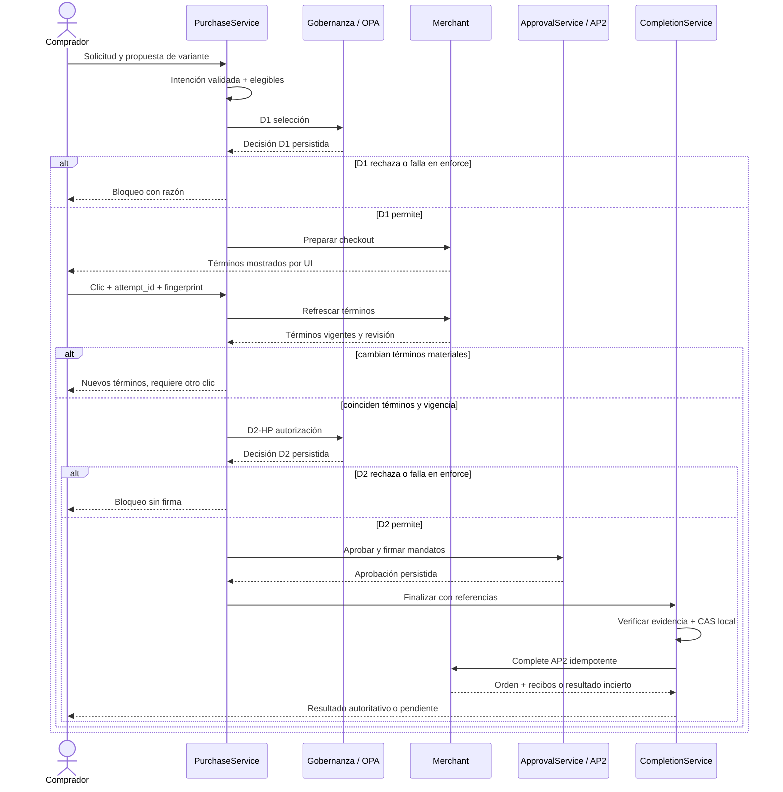
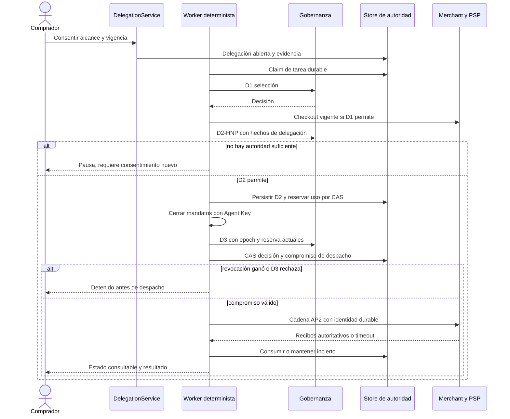

# Tesis · Roadmap del diseño final

Fecha: **11 de octubre de 2026**. El enfoque de gobernanza recibió el visto bueno en la reunión del 9 de octubre, según el reporte de Yair. Este documento propone las decisiones técnicas y las pruebas necesarias para congelar el diseño v1. Las recomendaciones técnicas aún no equivalen a decisiones aceptadas ni a funcionalidades implementadas.

El resultado buscado es un paquete que permita programar sin improvisar autoridad, contratos, persistencia o recuperación. Cada decisión debe tener una recomendación, su motivo, dependencias, un artefacto y una condición verificable de cierre.

**Ejemplo de recorrido:** una persona solicita un teléfono con un presupuesto máximo. El agente propone una variante elegible; el merchant calcula producto y envío; la interfaz presenta esos términos; la persona aprueba; el backend verifica vigencia y gobernanza, firma mandatos y completa. Si cambian los términos, solicita un nuevo clic. Si se pierde la respuesta, consulta la operación antes de comunicar el resultado.

**Alcance confirmado por Yair: Human Present y Human Not Present.** Ambos deben quedar diseñados para la primera arquitectura final. Se propone mantener B2C, un merchant configurado, una unidad, COP y pago sintético. B2B es una dimensión independiente y queda como extensión condicionada. La aprobación a gobernanza no se interpreta como aprobación previa de OPA o ACP.

**Ejemplo autónomo:** la persona consiente previamente una delegación para comprar una variante dentro de límites y vigencia explícitos. Después, sin un clic por esa transacción, el agente obtiene términos actuales, comprueba la delegación, reserva su uso y vincula mandatos cerrados a esa compra. Si no puede probar autoridad suficiente, detiene la operación o pide consentimiento nuevo. HNP conserva autorización humana previa; no consiste en omitir el control humano de la base existente.

## Cómo leer el roadmap

**Base** significa que existe en código o documentación actual. **Recomendación** es una elección concreta propuesta. **Prueba pendiente** exige un experimento técnico antes de cerrar. **Alcance pendiente** depende de la cobertura académica. Ninguna decisión técnica se marca cerrada solo por estar escrita aquí; el requisito HP+HNP sí está confirmado por Yair.

Primero se resuelven alcance, protocolo y consentimiento; después ubicación de controles, contratos y datos; luego concurrencia, operación y evaluación. El cronograma propuesto es 12–18 de octubre, con implementación desde el 19 si se cumplen los criterios de cierre. No representa horas ni responsables ya asignados.


| Hito | Ventana propuesta | Resultado para revisión | Depende de |
| --- | --- | --- | --- |
| M0 · Alcance y requisitos | 12 oct. | Casos de uso, límites, tratamiento experimental y requisitos identificados | Reporte de reunión + documentos de tesis |
| M1 · Perfil de protocolos | 12–13 oct. | ACP/AP2 HP+HNP; spike del puente HNP; comparación UCP; exclusiones/extensiones | M0 |
| M2 · Políticas y arquitectura | 14 oct. | D1/D2 por modo + D3-HNP, delegaciones, componentes/procesos y ADR del motor | M0/M1 |
| M3 · Estructuras y contratos | 15 oct. | Modelos tipados, relaciones, APIs y semántica de frescura | M1/M2 |
| M4 · Estados y consistencia | 15–16 oct. | Estados compra/grant/reserva, revocación, tareas, errores y reconciliación | M3 |
| M5 · Operación y evidencia | 16–17 oct. | Despliegue, confianza, límites medidos, auditoría y recuperación | M2/M3/M4 |
| M6 · Evaluación y congelación | 17–18 oct. | Trazabilidad, corpus, pruebas por mecanismo, documentos coherentes y backlog | M0–M5 |


## 1. Protocolos: selección propuesta y partes utilizadas

**Recomendación provisional:** conservar **ACP `2026-04-17` por REST + AP2 v0.2 para HP y HNP**. HP existe en B0; HNP requiere trabajo nuevo en los tres repositorios y una prueba obligatoria del puente. El helper AP2 fijado interpreta un checkout UCP, mientras el merchant actual firma un wrapper con un snapshot ACP: la compatibilidad HNP no está demostrada. Congelar ACP solo si un adaptador determinista permite verificar correctamente los mandatos abiertos contra los términos firmados originales. Si esa prueba falla o la extensión queda desproporcionada, elegir UCP REST y generar una base experimental común nueva.

UCP merece una comparación explícita: aporta negociación de capacidades y una extensión AP2 publicada. Adoptarlo requeriría cambiar discovery, metadatos, actualización de checkout, estados y representación criptográfica. Se reabre la elección si la tesis exige interoperabilidad AP2 publicada, negociación de capacidades o varios comercios heterogéneos. En ese caso, diseñar un perfil UCP REST antes de congelar una nueva base experimental.


| Pieza | Decisión propuesta | Responsabilidad en v1 | Condición que cambia la elección |
| --- | --- | --- | --- |
| ACP · 2026-04-17 | Incluir REST | Discovery, snapshot de productos, checkout, handler sintético, delegación y eventos de orden | Requisito de capacidades comerciales que este perfil no cubra |
| AP2 · v0.2 / e1ea56d | Incluir HP y HNP | HP: mandatos cerrados; HNP: abiertos + cierre por Agent Key; recibos y validación determinista | Spike del puente/SDK define perfil verificable y baseline nuevo para HNP |
| UCP · 2026-08-25 consultada | Alternativa real antes de congelar | Perfil comercial con extensión AP2 publicada y modelo que espera el helper del SDK | Puente HNP ACP inviable/costoso o requisito de interoperabilidad normativa |
| MCP · 2026-07-28 consultada | Excluir de v1 | Herramientas internas siguen como funciones tipadas | Cliente externo debe descubrir e invocar herramientas mediante MCP |
| A2A · 1.0.0 consultada | Excluir de v1 | Merchant/PSP siguen como servicios deterministas | Agente externo independiente con Agent Card, tareas y artefactos propios |
| TAP · Visa | Excluir de v1 | Confianza fijada con merchant/PSP configurados | Terceros necesitan reconocer al agente y sus firmas dentro de una red de confianza |
| OPA/Rego | Motor recomendado; fijar versión tras prueba | Evaluar decisiones de gobernanza; no es protocolo comercial | No aportar valor suficiente frente a evaluador Python equivalente o incumplir límites operativos |


| Módulo ACP | Usar | Límite explícito | Artefacto de cierre |
| --- | --- | --- | --- |
| Discovery | /.well-known/acp.json; versión, origen, REST y servicios compatibles | Discovery no establece confianza por sí solo | Perfil compatible/incompatible y validación de origen |
| Productos | Esquema Product y snapshot completo | /feeds/current es publicación propia por pull; no Feed API push/incremental | Mapeo feed → candidatos y prueba de snapshot inválido |
| Checkout | Create, get, update, cancel; complete a través del puente AP2 propio | Una unidad, moneda COP, un merchant; estados no soportados se rechazan explícitamente | Operaciones, cuerpos, headers, errores y estados contra bundle congelado |
| Fulfillment | Buyer/destino y selección de envío físico | Sin pickup, delivery digital o múltiples grupos en v1 | Términos aprobados incluyen envío y destino |
| Handler + Delegate Payment | tesis_sandbox, token opaco y allowance acotado | Confirm/lookup/receipt del sandbox son contratos propios; sin dinero real o 3DS | Delegación repetida, mismatch, rechazo y expiración |
| Order + webhook | Orden autoritativa; autenticación, dedupe y proyección de eventos | Sin refunds, disputas o chargebacks | Evento repetido/fuera de orden/de otro merchant |
| Módulos adicionales | Exclusión razonada | Cart independiente, Feed API push, binding MCP, descuentos/loyalty y Delegate Authentication | Requisito que justificaría reabrir cada módulo |


El contrato fijado prevalece sobre ejemplos narrativos sin versión. En el OpenAPI ACP congelado, `Idempotency-Key` es obligatorio en los POST. El adaptador debe normalizar estados y errores del perfil; no debe interpretar un estado desconocido como permiso para completar. Fuentes: [Checkout OpenAPI](https://github.com/agentic-commerce-protocol/agentic-commerce-protocol/blob/7fdd78df677a94dce04c770644b0fbbb1401272b/spec/2026-04-17/openapi/openapi.agentic_checkout.yaml) y [JSON Schema](https://github.com/agentic-commerce-protocol/agentic-commerce-protocol/blob/7fdd78df677a94dce04c770644b0fbbb1401272b/spec/2026-04-17/json-schema/schema.agentic_checkout.json). La [release de abril](https://github.com/agentic-commerce-protocol/agentic-commerce-protocol/blob/7fdd78df677a94dce04c770644b0fbbb1401272b/changelog/2026-04-17.md) identifica módulos disponibles; disponibilidad no implica que el proyecto deba implementarlos todos. El [Feed API fijado](https://github.com/agentic-commerce-protocol/agentic-commerce-protocol/blob/7fdd78df677a94dce04c770644b0fbbb1401272b/spec/2026-04-17/openapi/openapi.feed.yaml) describe publicación push, distinta de la ruta pull propia.

### ACP y UCP sobre la misma compra


| Paso | ACP fijado | UCP consultado | Implicación |
| --- | --- | --- | --- |
| Discovery | /.well-known/acp.json | Perfiles Business/Platform + /.well-known/ucp | UCP añade composición y negociación de capacidades |
| Crear / consultar | POST /checkout_sessions; GET por id | POST /checkout-sessions; GET por id | Se puede conservar un puerto interno; cambia el adaptador |
| Actualizar | POST por id | PUT por id, reemplazo del checkout | No es suficiente renombrar endpoints |
| Completar / cancelar | POST .../complete y .../cancel | POST .../complete y .../cancel | Traducir estados, errores e idempotencia del perfil |
| Autorización AP2 | Puente propio /ap2/checkout-jwt y /ap2/complete | Extensión dev.ucp.common.payment.ap2_mandate | Representación criptográfica y contrato diferentes |


Fuentes comparadas: [UCP REST](https://ucp.dev/2026-08-25/specification/shopping/checkout/rest/), [checkout y estados UCP](https://ucp.dev/2026-08-25/specification/shopping/checkout/) y [discovery/capacidades](https://ucp.dev/2026-08-25/specification/overview/). La [extensión AP2 de UCP](https://ucp.dev/2026-08-25/specification/payment/extensions/ap2-mandates/) utiliza `merchant_authorization` con JWS detached sobre checkout canonicalizado mediante JCS; el puente actual usa Checkout JWT. Se documentan como perfiles distintos.

### AP2: responsabilidades, no un servicio por cada rol

En HP se utilizarán mandatos cerrados: merchant firma checkout; Trusted Surface presenta términos; backend verifica consentimiento y firma; merchant/proveedor verifican y devuelven recibos. En HNP se añadirá la delegación abierta y su cierre posterior, descritos abajo. El sandbox puede asumir Credential Provider y Merchant Payment Processor, documentando ambas responsabilidades. [Especificación AP2 fijada](https://github.com/google-agentic-commerce/AP2/blob/e1ea56db72a6385bce3e5c1112b3a56ce60acb43/docs/ap2/specification.md).

El perfil debe fijar `vct`, hash del JWT original, algoritmos, emisores, audiencias aplicables, claves de confianza, moneda/monto, expiración y asociación de recibos. [Checkout Mandate](https://github.com/google-agentic-commerce/AP2/blob/e1ea56db72a6385bce3e5c1112b3a56ce60acb43/docs/ap2/checkout_mandate.md) y [Payment Mandate](https://github.com/google-agentic-commerce/AP2/blob/e1ea56db72a6385bce3e5c1112b3a56ce60acb43/docs/ap2/payment_mandate.md). La firma del proveedor del agente tras consentimiento autenticado requiere confianza explícita de los verificadores; no equivale a una clave individual del comprador. [Modelo de autorización](https://github.com/google-agentic-commerce/AP2/blob/e1ea56db72a6385bce3e5c1112b3a56ce60acb43/docs/ap2/agent_authorization.md).

MCP, A2A y TAP se evalúan por la interacción que habilitarían: [herramientas MCP](https://modelcontextprotocol.io/docs/2026-07-28/learn/architecture), [agentes independientes A2A](https://a2a-protocol.org/latest/specification/) y [reconocimiento de agentes TAP](https://developer.visa.com/capabilities/trusted-agent-protocol/trusted-agent-protocol-specifications/). HNP por sí solo no exige ninguno de ellos.

### Perfil Human Not Present que se debe cerrar

AP2 v0.2 define `mandate.checkout.open.1` y `mandate.payment.open.1`, ligados mediante `cnf` a una clave de agente. La persona consiente su contenido en Trusted Surface; después el agente vincula mandatos cerrados a una transacción y presenta la cadena. Restricciones desconocidas fallan. Esta semántica procede del [modelo de autorización](https://github.com/google-agentic-commerce/AP2/blob/e1ea56db72a6385bce3e5c1112b3a56ce60acb43/docs/ap2/agent_authorization.md); `IntentMandate` no será el tipo normativo v0.2. `PurchaseIntent` y `DelegationGrant` son estructuras propias.

**Propuesta de autonomía mínima:** una delegación para una sola compra futura, merchant/moneda/destino acotados, cantidad y gasto máximo incluidos gastos de envío, vigencia explícita y sin subdelegación. No ampliar a compras recurrentes ni presupuesto empresarial compartido por implicación. Los valores concretos y variantes permitidas se muestran al crear la delegación; el LLM no los inventa ni los expande.


| Decisión | Human Present | Human Not Present |
| --- | --- | --- |
| Consentimiento | Clic sobre términos exactos de esa compra | Consentimiento previo sobre alcance, restricciones y vigencia de delegación |
| Autoridad de firma | Proveedor de agente después de Trusted Surface autenticada | Emisor de delegación separado del Agent Key que prueba posesión al cerrar; LLM sin acceso a ninguna clave |
| Objetos AP2 | Checkout/Payment Mandates cerrados | OpenCheckout + OpenPayment + cadena a mandatos cerrados + recibos |
| Cambio de términos | Nueva presentación y nuevo intento | Recotizar y cerrar contra términos nuevos solo si siguen dentro del alcance; fuera de él, detener/pedir nueva delegación |
| Uso/cupo | Idempotencia de aprobación y compra | Registro durable de delegación + reserva/consumo/liberación, además de idempotencia de compra |
| Revocación | Cancelar o invalidar aprobación aún no despachada | Estado/epoch autoritativos; carrera con compromiso de despacho especificada |
| Ejecución | Solicitud interactiva | Tarea durable con condición/fecha de activación y worker acotado; no depende de que la pestaña siga abierta |
| Base experimental | B0 existente, con cambios comunes controlados | Nueva base HNP equivalente antes de comparar B0/B2; no comparar HP con HNP y atribuir diferencia a gobernanza |


Constraints estándar a perfilar: `checkout.allowed_merchants`, `checkout.line_items`, `payment.allowed_payees`, `payment.amount_range`, `payment.allowed_payment_instruments` y `payment.reference`. Destino, semántica de preferencias y lifecycle son controles propios; si deben probarse criptográficamente ante terceros, requieren extensión con schema y algoritmo compartido. Fuentes: [Checkout constraints](https://github.com/google-agentic-commerce/AP2/blob/e1ea56db72a6385bce3e5c1112b3a56ce60acb43/docs/ap2/checkout_mandate.md) y [Payment constraints](https://github.com/google-agentic-commerce/AP2/blob/e1ea56db72a6385bce3e5c1112b3a56ce60acb43/docs/ap2/payment_mandate.md).

El SDK espera un checkout UCP directamente en el JWT; el wrapper ACP y sus estados necesitan adaptación explícita. [CheckoutMandateChain fijado](https://github.com/google-agentic-commerce/AP2/blob/e1ea56db72a6385bce3e5c1112b3a56ce60acb43/code/sdk/python/ap2/sdk/checkout_mandate_chain.py). AP2 exige evitar cierres solapados y conservar la relación mandato abierto–cerrado–recibo. [Double Spend](https://github.com/google-agentic-commerce/AP2/blob/e1ea56db72a6385bce3e5c1112b3a56ce60acb43/docs/ap2/security_and_privacy_considerations.md), [flujo HNP](https://github.com/google-agentic-commerce/AP2/blob/e1ea56db72a6385bce3e5c1112b3a56ce60acb43/docs/ap2/flows.md). La gestión/revocación remota inmediata no tiene un endpoint normativo en el perfil consultado. [Mandate Management y Agent Key](https://github.com/google-agentic-commerce/AP2/blob/e1ea56db72a6385bce3e5c1112b3a56ce60acb43/docs/ap2/implementation_considerations.md).

La revocación operativa, reservas de uso, activación y consumo no aparecen resueltos por incluir una firma AP2: se especificarán como contratos de aplicación y sandbox. Merchant y proveedor deben verificar independientemente las restricciones que les corresponden; un `allow` de OPA no sustituye esa verificación.

**Prueba decisiva del puente:** abrir una delegación, cerrar sobre checkout ACP válido, verificar cadena en merchant y pago en proveedor, rechazar un total/merchant/variante fuera del alcance y repetir sin doble uso. Mantener hash del JWT original; no crear una conversión que desvincule los términos verificados de los firmados. Documentar cada adaptación y limitación; no declarar conformidad HNP antes de esa prueba.

## 2. Qué será componente, clase, proceso o servicio

**Recomendación:** agente como monolito modular, OPA local como proceso separado y merchant/proveedor como servicios externos. `PurchaseService`, `ApprovalService` y `CompletionService` son clases Python en el proceso del agente. La gobernanza también será un componente en ese proceso; no hace falta crear una API de gobernanza propia adicional.


**Comprador**

- UI / Trusted Surface

- Consentimiento HP sobre términos o HNP sobre límites

**Proceso del agente**

- API + identidad

- LangGraph + intención

- Compra · D1/D2 + D3-HNP

- Delegaciones + worker durable

- Gobernanza + evidencia

- ApprovalService + AP2

- CompletionService

- Módulos y clases Python; SQLite propia + checkpoints separados

**Proceso OPA**

- Rego + datos fijados

- Hechos JSON → allow / denySin capacidad de compra o firma

**Servicio merchant**

- ACP + puente AP2

- Catálogo, revisión, inventario y orden en PostgreSQL

**Servicio proveedor sandbox**

- Credential Provider + MPP

- Delegación, confirmación y recibo en SQLite propia

- UI ↔ agente: API autenticada · agente ↔ OPA: HTTP local · agente ↔ merchant: ACP + puente AP2 · agente/merchant ↔ proveedor: credenciales separadas

Topología propuesta; las fronteras muestran quién conserva la autoridad y el estado.


| Pieza | Forma | Reutiliza / dónde vive | Responsabilidad |
| --- | --- | --- | --- |
| Conversación | Componente en proceso | application/conversation.py · ConversationService | Intención, aclaraciones, búsqueda y presentación |
| Compra | Servicio de aplicación / clase | application/purchase.py · PurchaseService | Aplicar D1/D2 y despachar por modo HP/HNP sin bypass de LangGraph |
| Delegación HNP | Módulo/clases Python propuestos | delegation/{models,service,store}.py + application/authorization.py | Crear/revocar delegaciones; resolver autoridad; reservar y materializar mandatos; no fingir un clic HP |
| Activación HNP | Worker acotado en proceso para v1 | application/autonomous_execution.py propuesto + tareas durables en store | Activar, claim, revalidar y recuperar; una instancia, sin scheduler distribuido |
| Gobernanza | Módulo Python propuesto | governance/{models,ports,assembler,opa,reasons}.py | Ensamblar hechos, evaluar, validar y persistir decisión |
| Motor de política | Proceso OPA local/sidecar | policies/commerce/v1 + deploy/opa propuestos | Evaluación declarativa; no autenticación ni efectos |
| Frescura | Componente propuesto | application/offer_freshness.py + contrato merchant | Recotizar y comparar términos materiales |
| Consentimiento y firma | Puertos/clases en proceso | approval.py HP; emisores y AgentKeySigner HNP propuestos | Separar emisión tras consentimiento de cierre delegado; firmas deterministas después de D2 |
| Finalización | Clase en proceso | completion.py · CompletionService | Exigir evidencia correlacionada, CAS, pago, orden y reconciliación |
| Persistencia | Repositorio en proceso | persistence/sqlite.py · SqliteAgentStore | Transiciones locales atómicas e historial de decisiones/intentos |
| Adaptador ACP | Cliente en proceso | acp/client.py · ACPClient | Implementar CheckoutGateway y TrustedCompletionGateway; validar frontera |
| Composición | Composition root | runtime.py · build_runtime | Inyectar evaluador, modos, relojes y configuración |


OPA admite integración mediante REST o runtimes embebidos. Para este Python experimental se recomienda HTTP local detrás de `PolicyEvaluator`, evitando acoplar la aplicación a detalles de Rego. La elección se valida con una prueba de latencia, readiness y fallo. [Integración OPA](https://www.openpolicyagent.org/docs/integration). Cedar sigue siendo una alternativa válida para autorización principal–acción–recurso; no se descarta por supuesta incapacidad. [Semántica Cedar](https://docs.cedarpolicy.com/auth/authorization.html).

## 3. Políticas: catálogo inicial y dueño de cada control

El catálogo organiza **reglas declarativas**, **invariantes de aplicación**, **recuperación conversacional** y **validación comercial/criptográfica**. La cantidad de reglas no determina el número de llamadas OPA.

Se proponen **D1** antes de crear checkout y **D2** antes de materializar mandatos: D2-HP valida intento presentado; D2-HNP valida delegación y términos vigentes. Para HNP se añade **D3**, junto al compromiso durable de despacho, con estado/epoch/reserva actuales. D3 no elimina por sí sola la carrera con revocación: necesita la transacción descrita más abajo. `PolicyDecision` admite `allow|deny`; pedir consentimiento nuevo es un resultado del orquestador. Evidencia, reservas y revalidación son pasos fijos, no instrucciones arbitrarias de OPA.


| Política / regla | Dueño / hechos | Rechazo |
| --- | --- | --- |
| POL-01 · D1: Elegida pertenece al conjunto elegible de la misma intención | Rego + PurchaseService.start. Hechos: selected_id, eligible_ids, intent_ref, feed_ref. | deny; cero checkout |
| POL-02 · D1: Acción y merchant están permitidos por el perfil de compra | Rego; hechos ensamblados por backend. Hechos: prepare_checkout, merchant_ref, policy data. | deny; no invocar merchant |
| POL-03 · D2: Acción de compra permitida para principal y contexto verificados | Rego; autenticación/ownership siguen en API. Hechos: principal_ref, owns_run, complete_purchase. | deny; no firmar |
| POL-04 · D2: D1, intención, selección e intento pertenecen al mismo episodio | Rego + integridad de referencias Python. Hechos: D1 ref, intent version, variant, run, attempt. | deny; no reutilizar un allow ajeno |
| POL-05 · D2: Checkout actual satisface moneda, cantidad y límites de la intención | Rego sobre hechos tipados; guardas comunes se conservan. Hechos: currency, quantity, total_minor, hard limits. | deny; nuevo flujo/selección si hace falta |
| POL-06 · D2: Contexto y decisión previa corresponden a la versión permitida | Rego + verificación de despliegue. Hechos: schema, context version, D1 bundle, configured policy version. | deny; reevaluar explícitamente |
| POL-07 · D2-HNP: Delegación activa, no expirada y vinculada a principal/agente/acción | Rego sobre estado resuelto por backend; firmas fuera de OPA. Hechos: grant facts, owner/agent refs, validity, server_now. | deny; no cerrar mandato |
| POL-08 · D2-HNP: Términos dentro de merchant, productos, destino, moneda, cantidad y gasto delegados | Rego como gobernanza + verificadores AP2 independientes. Hechos: restricciones tipadas y checkout vigente. | deny; detener o pedir delegación nueva |
| POL-09 · D2/D3-HNP: Uso permitido y reserva exclusiva para esta operación | Rego sobre hechos; ledger/CAS hace cumplir concurrencia. Hechos: grant limit/consumed/reserved + operation/reservation refs. | deny; no reutilizar delegación consumida |
| POL-10 · D3-HNP: Epoch, reserva, términos y decisiones siguen vigentes al comprometer despacho | Rego + unidad de trabajo con CAS autoritativo. Hechos: grant epoch, expected versions, D2/terms/reservation facts. | deny; liberar solo cuando se pruebe ausencia de efecto |


| Control | Dueño | Comportamiento requerido |
| --- | --- | --- |
| Ambigüedad / cero candidatos | ConversationService | Pregunta o explicación canónica; no crear checkout |
| Ownership / identidad | API + servicio de aplicación | API verifica JWT/owner; worker HNP usa identidad de servicio y owner del grant, sin conservar sesión humana; OPA no autentica |
| Frescura / cambio material | OfferFreshnessGuard + merchant | HP: volver a presentar; HNP: reevaluar alcance y generar cierre nuevo; no reutilizar términos obsoletos |
| Firma / expiración / correspondencia AP2 | AP2 + merchant/proveedor | Verificación determinista; nunca LLM o Rego criptográfico |
| Idempotencia / concurrencia | Stores locales + merchant/proveedor | Identidad durable por operación y compare-and-set; efectos remotos reconciliables |
| Fallo del motor | OpaPolicyEvaluator | Timeout, undefined, JSON inválido o versión inesperada bloquean avance en enforce |
| Evidencia antes de transición | GovernanceEvidenceStore + transacción local | En enforce no avanzar sin vínculo; shadow no bloquea por fallo de observación añadido |
| Herramientas y datos no confiables | Modelos, assemblers, allowlists | Catálogo/modelo no aportan identidad, secretos, autoridad ni precio final |


D1 vuelve explícita una condición que Python ya valida: su aporte propuesto es versionado y reconstrucción de la decisión, no una nueva garantía de elegibilidad. Las reglas D2 también deben justificar su valor incremental. El experimento medirá el paquete de gobernanza; atribuir mejoras específicamente a OPA requeriría un control Python equivalente.

Cada regla tendrá propietario humano por asignar, fuente del requisito, esquema de hechos, prioridad, razón canónica, ejemplo permitido/rechazado, prueba de fallo y revisión. Cambiar políticas requiere revisión y despliegue versionado; el agente y la UI de compra no las editan.

## 4. Estructuras de datos y contratos que hay que cerrar

Se reutilizan `PurchaseIntent`, `HardConstraints`, `SoftPreferences`, `CheckoutSession`, `ApprovalTerms` y `ApprovalRecord`. Los modelos nuevos serán estrictos y versionados. Separan datos para evaluación, estado operativo sensible y evidencia exportable.


| Estructura propuesta | Campos de diseño | Regla de integridad |
| --- | --- | --- |
| SelectionPolicyInput | schema, decision/run/trace, intent_ref, merchant_ref, action, eligible_variant_ids, selected_variant_id, feed_snapshot_ref | Hechos calculados por backend; sin catálogo libre o credenciales |
| AuthorizationPolicyInput | schema, run/trace, mode HP\|HNP, principal_ref, action, hard_constraints tipadas, selected_variant_id, hechos D1 resueltos (outcome/intent/selection/bundle), expected bundle/context, snapshots vigentes, total/currency/quantity, server_now; rama HP: attempt/material_match; rama HNP: grant/constraints/epoch/reservation facts | Backend resuelve y verifica referencias antes de OPA; un ID no contiene los hechos. Sin JWT, dirección o consultas del motor al store |
| PolicyDecision | decision_id, phase, allow\|deny, reason_codes, input_digest, engine_decision_id opcional, policy_version/digest, latency, mode | Version/digest esperados se verifican por configuración del runtime, no por eco del motor |
| MaterialTerms / OfferSnapshot | merchant, checkout, variant/lines, quantity, total/currency, fulfillment/destination binding, material_revision, expires_at, material_fingerprint, observed_at | Comparación semántica separada de updated_at; PII completa permanece en almacén protegido |
| ApprovalAttempt | attempt_id, run, owner, presented_snapshot, expected_fingerprint, request_digest, timestamp, outcome, resulting_decision/approval refs | Una presentación crea un intento; doble clic/retry conserva ese intento; nueva presentación crea otro |
| DelegationGrant | grant_id/version, owner, agent key ref, open checkout/payment refs, constraints tipadas, valid_from/expires_at, state, authority_epoch, consent evidence | Inmutable por versión; ampliar límites exige consentimiento nuevo; revocación/cupo se consultan en store autoritativo |
| GrantReservation / ExecutionTask | reservation/task/operation IDs, grant/version/epoch, amount/currency/uses, expected state, trigger/deadline, lease/claim, dispatch commitment, receipt refs | Una reserva activa por grant single-use; timeout conserva reserva; worker reiniciable no autoriza por sí mismo |
| DispatchPolicyInput | D2 facts resueltos, grant current epoch/status, reservation owner/state, terms validity, operation identity, expected state version, server_now | Comprobar de nuevo en CAS al guardar decisión + compromiso; no confiar solo en snapshot de OPA |
| DecisionEvidence | schema, run/trace, phase, mode, input mínimo canonicalizado, digest, decision, policy/engine identity, snapshot/attempt/grant/reservation/operation refs, sequence/time | Permite replay; un hash aislado no basta para reconstruir entrada |
| ExperimentManifest | commits, lock digests, model/prompt, catalog/corpus hashes, schemas, protocol profile, SDK, OPA/bundle, mode, seeds/clocks | Fijar antes de evaluar; distinguir tiempo sintético y expiración criptográfica real |


Identificadores: `run_id` conserva el significado actual de compra; `conversation_id` identifica conversación; `trace_id` correlaciona; `decision_id`, `snapshot_id` y `approval_attempt_id` son identidades distintas generadas por servidor. Ninguno autoriza acceso. `experiment_run_id` identifica una ejecución experimental y no debe confundirse con `run_id`. Moneda se normaliza explícitamente; los montos son enteros en unidad menor, nunca float.

### Esqueleto de puertos propuesto

Este ejemplo describe el contrato a acordar; todavía no es código implementado. Los servicios siguen usando los puertos comerciales existentes.


**src/commerce_agent/governance/ports.py · propuesto**

```python
class PolicyEvaluator(Protocol):
    def evaluate(self, policy_input: PolicyInput) -> PolicyDecision: ...


class GovernanceEvidenceStore(Protocol):
    def record_decision(self, decision: DecisionEvidence) -> None: ...


# La unidad de trabajo local vincula decisión + transición.
# PurchaseService nunca avanza solo porque recibió HTTP 200 de OPA.
```

- Líneas 1-2 · **Puerto pequeño:** Evaluador síncrono para integrarse con los servicios actuales; el adaptador impone timeout. PolicyInput es unión tipada D1/D2/D3; no diccionario libre.

- Líneas 4-5 · **Persistencia propia:** Contrato conceptual; la implementación de unidad de trabajo debe agrupar escritura y transición, sin transacción SQL abierta durante llamadas de red.

- Líneas 7-8 · **Enforcement:** Validar resultado, integridad, versión y persistencia antes del siguiente efecto.


| Almacén / tabla | Estado actual | Diseño que se debe especificar |
| --- | --- | --- |
| Agente · purchases / operation_keys | Existen | Añadir referencias a decisiones vigentes y operación/intento; claves y ownership explícitos |
| Agente · policy_decisions | Propuesta | PK decision_id; FK compra; fase/mode/digests/input mínimo; historial de allows y denies |
| Agente · offer_snapshots | Propuesta | PK snapshot_id; FK compra; versión material, fingerprint, observación y referencia protegida |
| Agente · approval_attempts | Propuesta | PK attempt_id; FK compra/snapshot; unicidad por intento + digest; resultado durable |
| Agente · approval_terms / approvals | Existen, se sobrescriben por run_id | Conservar proyección actual y añadir historial explícito; no llamarlas ledger append-only |
| Agente · completion_results / orders / webhook_events | Existen | Enlazar decisiones, consentimiento HP o delegación HNP, mandatos/recibos y proyección sin regresión |
| Agente · delegation_grants / grant_reservations | Propuestas HNP | Versiones de alcance y hash de mandatos abiertos; reserva única por delegación single-use; epoch y CAS con compromiso |
| Agente · execution_tasks / dispatch_outbox | Propuestas HNP | Trigger/deadline, claim con vencimiento, operación durable y resultado; no recrear identidad tras restart |
| Checkpoints LangGraph | SQLite separada | Memoria conversacional; no autoridad de compra ni doble verdad transaccional |
| Merchant / proveedor | PostgreSQL / SQLite independientes | Cada servicio mantiene su autoridad y sus claves idempotentes; sin acceso directo desde agente |


Las FK deben conservar el ámbito de compra/propietario. Definir índices, claves únicas, borrado/retención y migración con datos existentes. Proponer una sola instancia de agente con SQLite para v1; multi-instancia requiere rediseñar coordinación y migrar el store antes de afirmarla soportada.

Guardar snapshots mínimos y referencias suficientes para replay. Los mandatos/JWT necesarios para recuperación permanecen en almacenamiento operativo protegido, no en logs de política ni exportaciones. Un SHA-256 de correo o dirección no anonimiza datos de baja entropía: usar identificadores pseudónimos o HMAC con key_id cuando haga falta correlación. Append-only en aplicación no significa evidencia resistente a un administrador con acceso a la base.

## 5. Estados, frescura, idempotencia y fallos

La máquina actual usa `received`, `selected`, `checkout_prepared`, `awaiting_confirmation`, `approved`, `completing`, `uncertain`, `completed`, `canceled`, `failed`. Debe acordarse cómo representar bloqueos de política, cambios de términos y recuperación sin equiparar los estados del agente a los estados normativos del checkout.

### Secuencia Human Present propuesta




Detalle del flujo; cada rechazo o fallo detiene el efecto correspondiente. Los denies no siguen al siguiente paso.




Secuencia HNP propuesta. Rechazos de D1 y fallos de reserva también detienen. El compromiso tiene un orden explícito frente a revocación.


### Decisión crítica: refresco sin invalidación permanente

El código actual del merchant devuelve el checkout almacenado en GET. Update recotiza, pero incrementa revisión y cambia `updated_at` incluso sin cambio comercial. La huella actual incluye `updated_at`, y el JWT incorpora revisión. Un refresh ingenuo en cada clic podría exigir otro clic indefinidamente.

**Recomendación para probar:** refresco propio que recalcule estado actual y, si es inocuo, preserve **todo el contenido firmado y consentido**, incluida revisión, `updated_at` vinculante y bytes del Checkout JWT. Registrar `observed_at` aparte y actualizar la referencia de revalidación de oferta sin modificar ese contenido. Si hay cambio material, publicar otra revisión: HP vuelve a presentar; HNP reevalúa alcance y cierra contra términos nuevos. Rechazar expiración/stock inválido. `complete` debe contrastar atómicamente revisión y referencia de oferta revalidada contra estado comercial actual, sin pretender una transacción global con PSP. Documentar HTTP/auth/idempotencia como contrato local. Prueba mínima: oferta cambia internamente pero conserva términos → aprobación HP válida; precio/destino/envío cambian → aprobación HP inválida y HNP limitado por delegación.

La alternativa es huella material independiente y un Checkout JWT nuevo tras refrescar. Esa alternativa cambia cómo se vincula el clic al objeto firmado y necesita justificar ese vínculo explícitamente. La prueba debe decidir entre ambas; no se implementa de manera implícita. Cambiar un control compartido o el perfil de consentimiento exige una nueva base común o una condición experimental separada.


| Situación | Estado / respuesta propuestos | Dato que permite recuperar | Criterio de cierre |
| --- | --- | --- | --- |
| Intento humano repetido | Mismo resultado; cuerpo distinto entra en conflicto | attempt_id + request_digest | No duplicar firma/efecto lógico |
| Nuevo clic tras nuevos términos | Intento nuevo vinculado al snapshot nuevo | snapshot_id + attempt_id | No reutilizar aprobación anterior |
| Precio/envío/destino/variante/vigencia cambian | HP: nueva presentación; HNP: reevaluar alcance y cierre, o pausa | snapshots + consentimiento/grant | Cero aprobación obsoleta ni expansión de límites; sin loop técnico |
| D1/D2 deny o motor inválido | blocked con razón canónica en enforce | decision_id + retryability definida | Cero efecto; shadow registra sin cambiar B0 |
| Fallo al persistir evidencia añadida | Enforce: error y no avance; shadow: observación perdida sin bloquear B0 | Intento durable o ausencia explícita | Semántica por modo; no confundir evidencia añadida con store operativo |
| Fallo local después de D2 antes de aprobación | Reanudar mismo intento con contexto revalidado | D2 + estado de intento | No usar allow desconectado o contexto cambiado |
| Dos completions concurrentes | Solo un claim local; otro consulta | CAS + misma operación remota | Una orden; ningún cambio de clave para saltar reserva |
| Timeout tras despacho | uncertain; reconciliar antes de repetir | Clave durable + checkout/provider refs | No anunciar fallo o éxito sin evidencia |
| Pago confirmado y orden todavía desconocida | Resultado pendiente/reconciliación | Operación de pago + checkout | Resolver sin segundo cargo ni éxito prematuro |
| Webhook repetido/fuera de orden | Persistir/deduplicar; proyección monotónica | Firma, body digest, merchant y order refs | No contaminar compra ajena ni regresar estado |
| Dos tareas HNP sobre la misma delegación | Una reserva válida; otra espera/rechaza | grant hash + reserva + operación | Sin cierres solapados aunque checkout/idempotency keys difieran |
| Revocar HNP durante ejecución | Antes de compromiso: detiene; después: en curso y reconciliar | authority_epoch + orden durable de compromiso | UI no promete deshacer una operación ya comprometida |
| HNP fuera de límites, cnf ajeno o constraint desconocido | No firmar/despachar; requiere resolver o nuevo consentimiento | Chain/grant refs + razón canónica | Merchant/PSP rechazan independientemente de OPA |


En enforce, decisión y transición se guardan atómicamente en SQLite mediante una unidad de trabajo. Evaluar OPA y consultar merchant fuera de esa transacción; al persistir, comprobar versión local. Firma, guardado de aprobación y cambio a approved necesitan recuperación explícita. Una presentación HP crea un intento; doble clic y fallo reintentable conservan ese intento si sigue vigente; nueva presentación crea otro.

La llamada remota no comparte la transacción SQL. Merchant puede hacer stock y orden atómicos localmente; PSP está en otra frontera. Mantener identidad de operación, estado durable y reconciliación. Una decisión OPA no congela stock, precio ni autorización futura.

### Autoridad y consumo HNP junto al efecto

La propuesta serializa en un mismo store local revocación y compromiso: D2 reserva uso antes de cerrar; D3 evalúa hechos actuales; una transacción verifica de nuevo epoch/reserva/versión, guarda evidencia y compromete la operación en outbox. Revocación anterior a ese commit impide el despacho. Una revocación posterior detiene ejecuciones nuevas, pero esa operación ya está en curso y puede enviarse o haber llegado al verificador; requiere reconciliación. El worker conserva identidad y cadena al reintentar. No genera otro cierre mientras la presentación anterior siga sin resultado autoritativo, aunque una recotización nueva cumpla los límites.

Si se exige impedir también la aceptación remota después de revocar, hace falta una comprobación online en merchant/PSP y un contrato de orden compartido adicional. No se promete revocación distribuida instantánea. La reserva single-use se consume con recibos; una respuesta perdida no la libera. Antes de cualquier presentación remota, ausencia de despacho demostrada puede liberar la reserva. Si ya se presentó un cierre, rechazo firmado y reconciliado puede permitir otro según el perfil; un recibo de pago aislado no prueba que toda la compra terminó. Especificar transiciones de grant, reserva y compra por separado, incluyendo fallo parcial entre ambos verificadores.

## 6. Interfaces y ubicación en código

Reutilizar las rutas existentes de conversación, consulta, aprobación, cancelación y complete. La nueva aprobación necesitará `approval_attempt_id` generado por backend al presentar términos. El cliente devuelve esa referencia y el fingerprint; no aporta principal, monto autoritativo, claves idempotentes, flags de política o un `allow`.


**POST /purchases/{run_id}/approval** — HP: aprobar exactamente un intento presentado
Autenticación: JWT verificado + ownership del run
- `run_id` (path, string): obligatorio. 
- `approval_attempt_id` (body, string): obligatorio. 
- `expected_fingerprint` (body, string): obligatorio. 
- `checkout_jwt` (body, string): Perfil AP2 actual; validar sin copiar a evidencia pública.
```json
{"approval_attempt_id":"att_...","expected_fingerprint":"...","checkout_jwt":"<no registrar>"}
```

Respuestas:

- **200:** Intento aprobado o replay del mismo resultado; representación final por especificar.
- **409:** Términos/estado cambiaron o mismo intento con contenido distinto.
- **403:** Acción no permitida; no revela existencia de compra ajena.
- **503:** Motor/evidencia no disponibles en enforce; no avanza.


| Interfaz propuesta de aplicación | Autoridad | Contrato que hay que cerrar |
| --- | --- | --- |
| Preparar y consentir delegación | Usuario autenticado en Trusted Surface | Alcance mostrado, versión, consentimiento, emisión abierta y replay; no autorización genérica del chat |
| Consultar / revocar delegación | Owner verificado por backend | Estado, epoch, usos y operaciones en curso; revocación idempotente con orden durable |
| Crear / consultar tarea HNP | Owner + delegación válida; ejecución interna autenticada | Trigger/deadline, identidad de tarea, cancelación y estado; UI no puede forzar allow |
| Cerrar / presentar cadena | Backend determinista y Agent Key | No exponer signer al LLM ni bypass de aprobación; errores por modo y constraints soportados |


Acordar compatibilidad API, migración de cliente, códigos y payload de error antes de añadir el campo. La respuesta de política puede exponerse como razón canónica y referencia corta; no incluir hechos de autorización privados.

El adaptador OPA consultará una ruta fija, por ejemplo `POST /v1/data/commerce/governance/decision`, con `{"input": ...}`. HTTP 200 sin `result` representa documento indefinido y debe bloquear en enforce. No se aceptan outcomes, razones o campos no definidos. [REST API OPA](https://www.openpolicyagent.org/docs/rest-api).


**application/purchase.py · inserciones propuestas sobre PurchaseService**

```python
# start(): reutilizar rank_candidates y selección validada.
selection = rank_candidates(feed, intent)
# D1: ensamblar hechos, evaluar, validar y persistir + claim local.
# Solo un allow vinculado al estado permite create_checkout().

# approve(): reutilizar ownership, checkout y ApprovalService.
# 1. Resolver intento + refrescar términos + comparar contenido material.
# 2. D2: evaluar y persistir antes de cualquier firma AP2.
# 3. ApprovalService.approve(...): firmar y persistir aprobación.
# 4. Actualizar etapa con la misma versión esperada o recuperar el intento.
```

- Líneas 1-4 · **D1 cerca del efecto:** El control vive en el servicio de aplicación y cubre invocaciones que no pasen por LangGraph.

- Líneas 6-8 · **D2 antes de firma:** ApprovalService.approve actualmente firma AP2 antes de guardar. La inserción debe preceder esa llamada.

- Líneas 9 · **Persistencia recuperable:** Definir transacción y recuperación del intento; las escrituras actuales separadas no constituyen la nueva garantía.


La implementación futura añadirá `governance/`, `delegation/`, autorización/worker HNP, frescura, políticas y configuración OPA. Modificará compra, aprobación HP, completion, store, runtime y UI. Merchant/proveedor necesitarán recepción/verificación de cadenas HNP, restricciones y recuperación, además del refresco si gana esa opción. No se habilitará HNP pasando `human_approved=True` ni desactivando el guard HP. Todo ello es backlog posterior al diseño.

## 7. Operación, seguridad y evolución B2B


| Tema | Recomendación | Qué falta para cerrar |
| --- | --- | --- |
| Bundle OPA | Estático local, versión/digest de motor y artefacto; sin actualización remota durante experimento | Build reproducible, digest verificado y prueba de bundle ausente/incompatible |
| Superficie OPA | Red privada/loopback y API de evaluación cerrada; agente no administra políticas | Config de rutas, readiness y prueba de inaccesibilidad desde UI/LLM |
| Modos | off, shadow, enforce cerrados y registrados por episodio | Shadow no modifica B0; enforce nunca cae a off por error |
| Disponibilidad/latencia | Definir timeout y límites con benchmark local antes de freeze | p50/p95/p99, fallos, presupuesto máximo por decisión y end-to-end |
| Confiabilidad | Persistencia durable, backup y reconciliación al reiniciar | Pruebas de restart en cada punto de firma/pago/orden |
| Claves | Claves por rol, trust anchors fijados, key_id y procedimiento de rotación | Audiencias/expiración/tolerancia y prueba de emisor o clave incorrectos |
| Evidencia | Ledger de aplicación antes del efecto; logs OPA complementarios | Allowlist de campos, retención/acceso, replay y detección de secretos |


| Mecanismo | off | shadow | enforce |
| --- | --- | --- | --- |
| Deny del PDP añadido | No evaluar | Registrar, continuar base equivalente | Bloquear el efecto correspondiente |
| Timeout/undefined/bundle inválido | Sin dependencia del PDP | Pérdida de observación, continuar base | Bloquear y exponer fallo operativo |
| Fallo de evidencia añadida | Sin dependencia añadida | Contabilizar observación perdida, no bloquear base | No avanzar sin decisión vinculada |
| Fallo de persistencia operativa/mandato/reserva | Controles comunes de base | Controles comunes de base | Bloquear según control común; no continuar sin autoridad |
| Frescura que muta merchant | Contrato común fijado por baseline | Observar sin mutar; o declarar otra condición experimental | Contrato de frescura del tratamiento documentado |
| HNP: firma/constraints/uso/revocación | Obligatorios en base HNP equivalente | No se deshabilitan para preservar autoridad | Obligatorios además de PDP/evidencia |


Los modos afectan al tratamiento de gobernanza añadido; no habilitan comprar sin consentimiento o sin verificar AP2. El B0 actual solo cubre HP. La base HNP debe construirse con los controles comunes imprescindibles antes de comparar. Fijar por episodio perfil, modo y mecanismos; los fallos de observación en shadow entran en métricas de cobertura.

Los [bundles OPA](https://www.openpolicyagent.org/docs/management-bundles) admiten firma y metadatos de revisión; decidir el mecanismo de integridad del artefacto desplegado, sin tratar la revisión declarada como prueba suficiente. Los [decision logs](https://www.openpolicyagent.org/docs/management-decision-logs) pueden incluir input y resultado y permiten masking; no sustituyen la persistencia transaccional de evidencia de la compra.

### Ruta B2B condicionada al alcance

Si B2B debe implementarse, ampliar el diseño antes de congelar: organización/membresía, roles solicitante/aprobador, mandato organizacional versionado, presupuesto compartido, reservas y revocación. La autorización organizacional es un contrato de aplicación adicional; no se declara implementada por tener mandatos AP2 Human Present.


| Adición | Estructuras/controles necesarios | Prueba que demuestra cierre |
| --- | --- | --- |
| Roles y autoridad | Organization, Membership, OrganizationalMandate; scope/owner/roles | Solicitante no aprueba por inventar un campo o reutilizar identidad |
| Presupuesto compartido | BudgetAccount + Reservation; reserva/consumo/liberación atómicos | Dos compras concurrentes no exceden saldo; timeout no libera sin resolver efecto |
| Revocación | authority_epoch + evento; orden entre revocar y comprometer despacho | Carrera revocación/despacho con semántica explícita del efecto en curso |
| Decisión próxima al efecto | D3 o lease/versión de autorización consumible; datos dinámicos autoritativos | Rechazar autorización obsoleta; D3 aislada no pretende cerrar toda ventana TOCTOU |
| Coordinación | Reevaluar PostgreSQL para store de autoridad y despliegue | Transacciones, bloqueos y reconciliación entre servicios probados |


HP y HNP sí forman parte del alcance confirmado. B2B, recurrencias, subdelegación y jerarquías de mandatos son ampliaciones independientes. Reserva y revocación de delegación personal HNP ya pertenecen al núcleo y no esperan a B2B.

## 8. Registro de decisiones y entregables

Cada fila es una unidad de trabajo de diseño. La elección propuesta debe pasar su evidencia antes de recibir estado cerrado. Los responsables se asignarán por persona según disponibilidad; las responsabilidades de los componentes ya aparecen arriba.

### Decisiones M0


| Decisión / estado | Propuesta / entregable | Cierre / dependencias |
| --- | --- | --- |
| D01 · Alcance funcional. Estado: Recomendación | HP + HNP confirmados; B2C/compra única propuestos; B2B independiente. Entregable: scope.md | Modos confirmados por Yair; cerrar límites y profundidad de cada caso. Depende de: — |
| D02 · Casos de uso y requisitos. Estado: Recomendación | Compra válida + recuperación + amenazas por requisito. Entregable: requirements.md | Cada requisito tiene ID, dueño, prioridad y oráculo. Depende de: D01 |
| D03 · Tratamiento experimental. Estado: Recomendación | Paquete gobernanza; no atribuirlo solo a OPA. Entregable: experiment-design.md | Variables mantenidas constantes y mecanismos separados. Depende de: D01 |


### Decisiones M1


| Decisión / estado | Propuesta / entregable | Cierre / dependencias |
| --- | --- | --- |
| D04 · Protocolo comercial. Estado: Prueba pendiente | ACP REST provisional; UCP si falla puente HNP. Entregable: protocol-profile.md + ADR-001 | Comparación ACP/UCP y spike HNP contra requisitos y estándar/propio. Depende de: D02, D03, H01 |
| D05 · Módulos comerciales. Estado: Recomendación | Discovery/product snapshot/checkout/fulfillment/payment/order events. Entregable: protocol-coverage.csv | Operación/campo/estado → fuente congelada → prueba. Depende de: D04 |
| D06 · Autorización del pago. Estado: Recomendación | AP2 v0.2 HP cerrado + HNP abierto/cierre; claves separadas. Entregable: ap2-profile.md | Actores, claims, firmas, trusts, expiración y recibos. Depende de: D04 |
| D07 · Bridge ACP–AP2. Estado: Recomendación | Contrato propio HP/HNP sobre JWT, cadena, revisión y constraints. Entregable: bridge-contract.md | Vínculos términos/consentimiento/delegación/cadena/operación/recibos. Depende de: D05, D06 |
| D08 · MCP/A2A/TAP. Estado: Recomendación | Excluir con condición de reapertura. Entregable: ADR-002 | Una interacción ausente o requisito concreto por protocolo. Depende de: D02, D04 |
| H01 · Viabilidad criptográfica del puente HNP. Estado: Prueba pendiente | Spike ACP firmado → constraints AP2; comparar UCP. Entregable: hnp-bridge-spike.md | Cadena válida aceptada; cnf/hash/campo/límite alterados rechazados. Depende de: D02, D03 |


### Decisiones M2


| Decisión / estado | Propuesta / entregable | Cierre / dependencias |
| --- | --- | --- |
| D09 · Topología y fronteras. Estado: Recomendación | Agente modular + OPA separado + merchant/PSP externos. Entregable: architecture.md | Contexto/contenedores y autoridad de datos sin accesos cruzados. Depende de: D04, D06 |
| D10 · Puntos de enforcement. Estado: Recomendación | D1 selección; D2-HP/HNP antes de firma; D3-HNP junto a compromiso. Entregable: control-map.md | Todo camino a crear/firmar/completar pasa por guardas. Depende de: D09 |
| D11 · Motor de políticas. Estado: Prueba pendiente | OPA local detrás de PolicyEvaluator. Entregable: ADR-003 + spike report | Benchmark, fail closed y comparación Python/Cedar razonada. Depende de: D10 |
| D12 · Catálogo de políticas. Estado: Recomendación | POL-01–10; ledger, cripto y UX con dueños distintos. Entregable: policy-catalog.md | Hechos, dueño, razones, pruebas positivas/negativas por regla. Depende de: D10 |
| D13 · Resultados y obligaciones. Estado: Recomendación | allow/deny; recuperación y evidencia como pasos fijos. Entregable: policy-contract.json | Unknown/undefined/razón desconocida bloquean; no código dinámico. Depende de: D11, D12 |
| D14 · Gobierno de políticas. Estado: Recomendación | Revisión humana + bundle fijado y desplegado. Entregable: policy-lifecycle.md | Quién cambia, revisa, activa y revierte; agente sin escritura. Depende de: D11, D12 |
| H02 · Alcance de delegación autónoma. Estado: Recomendación | Una compra; merchant/variantes/cantidad/total/instrumento/TTL explícitos. Entregable: delegation-profile.md | UI muestra exactamente límites; schema distingue estándar y extensión. Depende de: D06, D12 |


### Decisiones M3


| Decisión / estado | Propuesta / entregable | Cierre / dependencias |
| --- | --- | --- |
| D15 · Modelos canónicos. Estado: Recomendación | Intención/checkout reutilizados; D1/D2/D3, grant y reserva tipados. Entregable: schemas/ | JSON válido/inválido y mapeo a modelos existentes. Depende de: D05, D13 |
| D16 · Identidad y correlación. Estado: Recomendación | run/conversation/experiment/trace/decision/attempt separados. Entregable: identity-map.md | IDs no autorizan; scope consistente en rutas/FK. Depende de: D15 |
| D17 · Frescura y consentimiento. Estado: Prueba pendiente | Refresh inocuo preserva todo contenido firmado/consentido. Entregable: freshness-contract.md + ADR-004 | Sin loop HP; HNP revalida alcance; complete contrasta oferta vigente. Depende de: D07, D15 |
| D18 · Persistencia y migraciones. Estado: Recomendación | Snapshots/decisiones/intentos/delegaciones; proyecciones actuales explícitas. Entregable: data-model.md + migration plan | PK/FK/unique/índices/retención y migración con datos existentes. Depende de: D15, D16, D17 |
| D19 · API y compatibilidad. Estado: Recomendación | Intento HP + gestión de delegación/tarea HNP; ownership servidor. Entregable: openapi-agent.yaml | Errores/replay/cambios materiales y migración UI coherentes. Depende de: D16, D17 |
| D20 · Contrato OPA. Estado: Recomendación | Ruta fija, schema validado, versión verificada. Entregable: opa-contract.json | 200 sin result/timeout/bundle distinto no habilitan. Depende de: D11, D13, D15 |
| H03 · Emisión y cierre de mandatos. Estado: Recomendación | Separar Trusted Surface/emisor de Agent Key/materializador. Entregable: delegation-crypto-contract.md | Consentimiento previo, cadena, cnf, audiencia/nonce y recibos verificables. Depende de: D07, H01, H02, D15, D16 |


### Decisiones M4


| Decisión / estado | Propuesta / entregable | Cierre / dependencias |
| --- | --- | --- |
| D21 · Máquinas de estado. Estado: Recomendación | Separar compra, checkout, intento HP, grant/reserva/tarea HNP y operación. Entregable: states.md | Cada transición tiene precondición, dueño y recuperación. Depende de: D18, D19 |
| D22 · Idempotencia. Estado: Recomendación | Identidades durables por operación/intento y reserva por delegación. Entregable: idempotency-matrix.md | Mismo body replay; mismatch conflicto; restart conserva identidad. Depende de: D18, D19 |
| D23 · Atomicidad local. Estado: Recomendación | Decisión/transición y grant/reserva/compromiso mediante UoW/CAS. Entregable: transaction-boundaries.md | Carreras y crash points sin efecto sin evidencia. Depende de: D18, D20, D21 |
| D24 · Incertidumbre y reconciliación. Estado: Recomendación | Consultar antes de redespachar; conservar clave. Entregable: recovery-sequences.md | Pago confirmado/orden desconocida y respuesta perdida recuperables. Depende de: D07, D22, D23 |
| D25 · Eventos de orden. Estado: Recomendación | Autenticación, dedupe y proyección monotónica. Entregable: event-contract.md | Duplicados/fuera de orden/merchant distinto sin contaminación. Depende de: D05, D18 |
| D26 · Integración UI. Estado: Recomendación | HP términos y presentación; HNP consentir límites, revocar y ver tarea. Entregable: ui-state-contract.md | La UI no inventa intención ni autoridad; cada bloqueo recuperable. Depende de: D19, D21, D24 |
| H04 · Ledger y doble uso de delegación. Estado: Recomendación | Reserva single-use + CAS por mandato abierto y operación. Entregable: grant-ledger.md | Dos checkouts distintos no producen cierres solapados; timeout no libera. Depende de: D18, D22, D23, H02 |
| H05 · Revocación frente a compromiso. Estado: Recomendación | Epoch + D3 y outbox en transacción; en curso se reconcilia. Entregable: revocation-order.md | Carreras antes/después del commit y fallo parcial entre verificadores. Depende de: H03, H04, D24 |


### Decisiones M5


| Decisión / estado | Propuesta / entregable | Cierre / dependencias |
| --- | --- | --- |
| D27 · Identidad/ownership. Estado: Recomendación | JWT verificado y scopes desde backend. Entregable: trust-boundaries.md | Intento de leer/aprobar compra de otro falla. Depende de: D09, D16, D19 |
| D28 · Claves/cripto/relojes. Estado: Recomendación | Claves emisor/Agent Key separadas; anchors, nonce/audiencia y relojes. Entregable: key-and-clock-profile.md | Issuer/audience/key/exp incorrectos rechazados; rotación especificada. Depende de: D06, D07, D27, H03 |
| D29 · Catálogo/LLM no confiables. Estado: Recomendación | Allowlist, schemas, herramientas de lectura, sin autoridad modelada. Entregable: threat-model.md | Inyección no modifica actor, total, política o efecto. Depende de: D10, D15, D27 |
| D30 · Evidencia y privacidad. Estado: Recomendación | Entrada mínima replayable + referencias; datos sensibles protegidos. Entregable: evidence-schema.json + retention.md | Replay reproduce decisión y exportación excluye secretos/PII. Depende de: D18, D23, D28 |
| D31 · Modos y readiness. Estado: Recomendación | off/shadow/enforce por episodio; readiness bundle/config. Entregable: runtime-contract.md | Matriz por mecanismo: shadow sin bloqueo añadido; enforce no degrada. Depende de: D14, D20, D23 |
| D32 · SLO/timeouts/límites. Estado: Prueba pendiente | Fijar números tras prueba local antes de evaluar. Entregable: operational-budgets.md | p95/timeout/body/concurrencia/retry budgets medidos y aceptados. Depende de: D11, D24, D31 |
| D33 · Despliegue/reinicio/backup. Estado: Recomendación | Instancia agente única y volúmenes persistentes. Entregable: deployment-runbook.md | Restart en compra pendiente y restore verificable. Depende de: D09, D18, D24, D31 |
| H06 · Activación y worker HNP. Estado: Recomendación | Tarea durable de compra única; claim acotado, deadline y restart. Entregable: autonomous-worker.md | Sin pestaña activa, retries/crash no recrean identidad ni amplían autoridad. Depende de: H04, H05, D31, D33 |


### Decisiones M6


| Decisión / estado | Propuesta / entregable | Cierre / dependencias |
| --- | --- | --- |
| D34 · Escenarios y oráculos. Estado: Recomendación | S01–S05 HP + HNP límites/cadena/revocación/concurrencia/recovery. Entregable: acceptance-matrix.csv | Requisito → control → caso → métrica/evidencia. Depende de: D12, D24, D25, D29, D30 |
| D35 · Corpus y comparación. Estado: Recomendación | Pares B0/B2 por modo; nueva base HNP; corpus reservado. Entregable: evaluation-manifest.json | Denominadores, semillas/configs y frozen artifacts trazables. Depende de: D03, D14, D34 |
| D36 · Atribución y límites. Estado: Recomendación | Medir paquete; ablación si se afirma beneficio específico del PDP. Entregable: analysis-plan.md | Resultados por mecanismo; no exigir mejora donde B0 ya controla. Depende de: D03, D35 |
| D37 · Consistencia documental. Estado: Recomendación | D1/D2 por modo y D3-HNP coherentes en todo artefacto. Entregable: design-index.md | Sin P1–P5 activo contradictorio ni HNP presentado como HP sin clic. Depende de: D10, D13, D15, D21, D34 |
| D38 · Handoff de implementación. Estado: Recomendación | Tareas por repo con dependencias y aceptación. Entregable: implementation-backlog.md | Compra y todos los fallos pueden recorrerse sin decidir contratos. Depende de: D01, D02, D03, D04, D05, D06, D07, D08, D09, D10, D11, D12, D13, D14, D15, D16, D17, D18, D19, D20, D21, D22, D23, D24, D25, D26, D27, D28, D29, D30, D31, D32, D33, D34, D35, D36, D37, H01, H02, H03, H04, H05, H06, H07, H08 |
| H07 · Aceptación de ambos modos. Estado: Recomendación | HP clic exacto; HNP límites y gestión de delegación. Entregable: hp-hnp-acceptance.csv | Cadena falsa/cnf ajeno/expiry/límites/unknown/revoke/doble uso/fallback. Depende de: H03, H04, H05, H06, D26 |
| H08 · Comparabilidad HP/HNP. Estado: Recomendación | Baseline común por modo antes de medir gobernanza. Entregable: hnp-baseline-manifest.json | No atribuir a PDP cambios de autonomía, protocolo o controles comunes. Depende de: H07, D35, D36 |


### Decisiones B2B


| Decisión / estado | Propuesta / entregable | Cierre / dependencias |
| --- | --- | --- |
| B01 · Roles y mandato organizacional. Estado: Alcance pendiente | Diseñar si B2B entra al núcleo. Entregable: b2b-authority.md | Roles y autoridad empresarial verificables. Depende de: D01, D27 |
| B02 · Presupuesto compartido. Estado: Alcance pendiente | Reserva/consumo/liberación atómicos. Entregable: b2b-budget.md | Dos compras concurrentes y efecto incierto sin sobregiro. Depende de: B01, D23, D24 |
| B03 · Revocación y efecto. Estado: Alcance pendiente | Epoch/lease + orden compromiso/revocación + D3 si procede. Entregable: b2b-revocation.md | Carreras y ventana hasta efecto explicitadas. Depende de: B01, B02, D28 |
| B04 · Persistencia y evaluación empresarial. Estado: Alcance pendiente | Reevaluar PostgreSQL y corpus B2B separado. Entregable: b2b-experiment.md | Aislamiento organizaciones y coordinación demostrables. Depende de: B02, B03, D35 |


## 9. Qué significa estar listos para implementar

El gate de congelación D38 exige todas las decisiones D01–D37 y H01–H08; B01–B04 solo si B2B entra al núcleo. Las tres pruebas prioritarias son H01 (puente HNP), D17 (frescura sin invalidar consentimiento) y D11 (integración/fallos OPA). El plazo semanal se reevalúa con esos resultados: HNP añade trabajo real y el 19 sigue siendo una fecha tentativa.

El paquete congelado incluirá un índice y registros de decisiones; perfil de protocolos; catálogo de políticas; contexto/contenedores/componentes; contratos JSON/OpenAPI; modelo ER con migraciones; máquinas de estado; secuencias de éxito y fallos; modelo de amenazas; runbook; esquema de evidencia; plan experimental; y backlog por repositorio. Los nombres del registro son entregables propuestos, no archivos que ya existan.

La validación del diseño consiste en recorrer los casos contra esos artefactos y resolver contradicciones. Las pruebas de código que se enumeran a continuación serán requisitos de implementación; no se presentan como ejecutadas para funcionalidades aún inexistentes.


- [ ] HP y HNP cubiertos; límites de autonomía y alcance B2B explícitos
- [ ] Cada módulo incluido tiene versión/fuente, operación, mapeo y prueba; las extensiones propias están identificadas
- [ ] Cada política tiene dueño, hechos, razón, enforcement y casos permitidos/rechazados
- [ ] Frescura resuelta sin GET obsoleto ni bucle de aprobación por timestamps
- [ ] Modelos, IDs, FK, índices, unicidad, retención y migración especificados
- [ ] Transacciones locales, firma, CAS e idempotencia tienen recuperación en cada crash point
- [ ] Pago/orden desconocidos se reconcilian sin afirmar atomicidad entre servicios
- [ ] Versiones, bundle, claves, relojes, readiness y presupuestos operativos fijados
- [ ] La evidencia mínima permite replay sin secretos ni PII exportada
- [ ] Corpus/oráculos/métricas y tratamiento experimental definidos antes de medir B2
- [ ] Diagramas/contratos/manifiesto/backlog coinciden: D1/D2 por modo y D3-HNP
- [ ] Delegación, cadena, doble uso, revocación/compromiso y worker HNP tienen contratos verificables
- [ ] Una compra y sus fallos se recorren sin inventar una estructura, autoridad o transición


### Verificación futura de implementación

Usar contratos congelados, pruebas de políticas Rego, fallos OPA, ownership, frescura y persistencia. Añadir carreras y crash recovery que prueben la semántica, no solo funciones aisladas. El smoke integrado existente constituye el punto de partida para ejercer merchant y PSP como procesos separados; ampliar el runner a B2, ejecutar modo sombra y luego enforcement con el mismo episodio.


**tesis-commerce-agent · runner existente, ampliación B2 pendiente**

```sh
uv run python scripts/run_joint_e2e.py --ap2   --merchant-repo ../tesis-commerce-merchant   --payment-repo ../tesis-payment-provider-sandbox
```

Comando existente de integración AP2; no ejecuta gobernanza B2 por sí solo.


La aceptación B2 HP deberá comprobar: intento idéntico reintentado; precio material cambiado; revisión/timestamp sin cambio comercial; OPA caído/undefined; fallo de escritura; aprobación ajena; firma o recibo inválidos; dos completions; restart; pago confirmado con orden incierta; webhook repetido. HNP añade cadena falsa, cnf ajeno, scope expandido, constraint desconocido, dos cierres, expiry/revocación, activación sin navegador y fallo parcial entre verificadores. Verificar en bases y recibos el resultado, además de la narración de la UI.

### Evidencia de esta entrega

Se revisaron documentación, modelos, puntos de efecto y persistencia de los tres repositorios, además de especificaciones primarias. No se implementaron políticas, migraciones o rutas B2, ni se ejecutó una certificación de conformidad. Las recomendaciones se basan en el alcance actual y la inspección selectiva; las pruebas pendientes están identificadas en el registro.

### Open Questions


**¿Hay restricciones académicas o técnicas adicionales que cambien estas decisiones?**

Por ejemplo, exigir un protocolo concreto, múltiples comercios, un despliegue específico o soporte empresarial en la evaluación.


